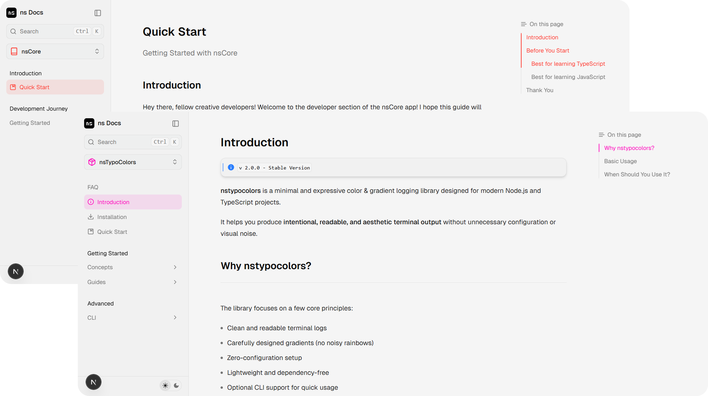

#  nsDocs

---

## About

**nsDocs** is a centralized documentation platform for open-source projects built and maintained by **nsgpriyanshu**.

- For **nsCore** documentation: https://nsdocs.vercel.app/docs/nscore
- For **nsTypoColors** documentation: https://nsdocs.vercel.app/docs/nstypocolors

  

---

## What You’ll Find

- Clean, minimal documentation UI
- Structured guides and references
- Practical examples and best practices
- Beginner-friendly and production-ready content

---

## Built With

- **[Next.js](https://nextjs.org/)** — React framework for performance and scalability
- **[Fumadocs UI](https://www.fumadocs.dev/)** — Purpose-built documentation system

---

## Contact

Have ideas or questions? Join our [Discord community](https://discord.gg/7SAcEv7MDd) or reach out via [GitHub issues](https://github.com/nsgpriyanshu/creatorsworld/issues) to connect with us.

---

## Contributor

---
